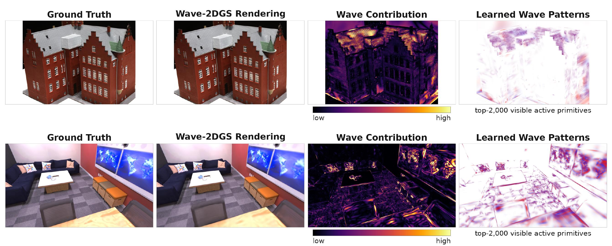

# Wave-2DGS

**Sparse local wave modulation for 2D Gaussian Splatting.**

<p align="center">
  
</p>

<p align="center">
  <em>From left: ground truth, Wave-2DGS rendering, normalized wave contribution, and projected local wave patterns on DTU (top) and Replica (bottom).</em>
</p>

Wave-2DGS extends [2D Gaussian Splatting (2DGS)](https://github.com/hbb1/2d-gaussian-splatting)
with one explicit, view-independent sinusoidal RGB residual per primitive. The
original spherical-harmonic branch still models view-dependent color, while the
wave branch provides spatial appearance variation in normalized tangent-plane
coordinates. A group-Lasso penalty suppresses unnecessary amplitudes, and a
zero amplitude exactly recovers the original 2DGS appearance.

This repository preserves the original 2DGS geometry, rasterization structure,
and densification policy. Wave parameters are inherited by cloned and split
primitives and then optimized independently.

## Highlights

- Switchable implementation: omit `--enable_primitive_wave` to run original 2DGS.
- Learnable RGB amplitude, 2D spatial frequency, and phase.
- Separate amplitude/frequency/phase learning rates.
- Group-sparse amplitude regularization and post-training sparsification.
- Replica RGB-D loading, shared-view rendering, and fixed-view geometry tools.
- DTU training and official geometry-evaluation runners.

## Installation

The code follows the original 2DGS environment and is intended for research and
evaluation use.

```bash
git clone --recursive https://github.com/JackmanYuan/Wave-2DGS.git
cd Wave-2DGS

conda env create --file environment.yml
conda activate surfel_splatting

bash scripts/install_extensions.sh
```

`install_extensions.sh` initializes the pinned upstream submodules, applies the
included Wave-2DGS rasterizer patch, and builds both CUDA extensions. Re-running
the script is safe when the patch is already applied. If the system CUDA
compiler differs from the CUDA version used by PyTorch, either select a conda
environment that includes a matching `nvcc` or set `CUDA_HOME` explicitly:

```bash
CUDA_HOME=/path/to/cuda-11.8 bash scripts/install_extensions.sh
```

## Dataset setup

Dataset files are kept under the repository-local `data/` directory, which is
ignored by Git. The examples below assume this layout:

```text
data/
├── Replica/
│   ├── office0/
│   ├── office1/
│   └── ...
├── cull_replica_mesh/        # optional, for geometry evaluation
│   ├── office0.ply
│   └── ...
├── DTU/                      # preprocessed 2DGS scenes
│   ├── scan24/
│   └── ...
└── DTU_Official/             # official geometry-evaluation data
    ├── ObsMask/
    └── Points/
```

- **Replica:** download the [NICE-SLAM RGB-D release](https://cvg-data.inf.ethz.ch/nice-slam/data/Replica.zip),
  which provides the `traj.txt` and `results/` layout expected by this loader,
  and extract it under `data/`. The optional
  [culled ground-truth meshes](https://cvg-data.inf.ethz.ch/nice-slam/cull_replica_mesh.zip)
  are used for geometry evaluation. See the
  [official Replica repository](https://github.com/facebookresearch/Replica-Dataset)
  for the dataset license and original assets.
- **DTU:** download the preprocessed scenes distributed by
  [2DGS on Hugging Face](https://huggingface.co/datasets/dylanebert/2DGS)
  (or its [Google Drive mirror](https://drive.google.com/drive/folders/1SJFgt8qhQomHX55Q4xSvYE2C6-8tFll9))
  into `data/DTU`. Geometry evaluation additionally requires the official
  [DTU Points and observation masks](https://roboimagedata.compute.dtu.dk/?page_id=36),
  arranged under `data/DTU_Official`.

Large datasets may remain on another disk by symlinking these subdirectories.
The exact expected structures are documented in
[docs/DATASETS.md](docs/DATASETS.md).

## Quick start

Original 2DGS remains the default:

```bash
python train.py -s data/Replica/office0 -m output/office0_baseline \
  --eval --replica_pose_convention raw
```

The selected Wave-2DGS configuration used in our main experiments is:

```bash
python train.py -s data/Replica/office0 -m output/office0_wave \
  --eval --replica_pose_convention raw \
  --enable_primitive_wave \
  --wave_k_init 3.1416 \
  --wave_amp_lr 0.001 \
  --wave_freq_lr 0.008 \
  --wave_phase_lr 0.001 \
  --wave_amp_group_lasso 0.03 \
  --wave_amp_group_lasso_start_iter 500
```

All original 2DGS training flags remain available. `--max_primitives` provides
an optional hard cap shared by baseline and Wave-2DGS runs.

Render a trained Wave-2DGS checkpoint:

```bash
python render_lite.py -s data/Replica/office0 -m output/office0_wave \
  --iteration 30000 --skip_train \
  --eval --replica_pose_convention raw \
  --enable_primitive_wave --wave_k_init 3.1416
```

## Replica paired experiment

Replica scenes are expected to contain `traj.txt` and `results/frame*.jpg` /
`results/depth*.png`. The paired runner trains original 2DGS and Wave-2DGS with
the same seed, 50k cap, densification schedule, initializer, and 16 held-out
views:

```bash
SOURCE_PATH=data/Replica/office0 \
OUTPUT_ROOT=output/replica_wave2dgs_3k \
SEED=0 \
bash scripts/run_replica_wave2dgs.sh
```

The final comparison is written to
`<output>/<scene>/seed_<seed>/paired_summary.csv`.

For matched fixed-view TSDF reconstruction:

```bash
SOURCE_PATH=data/Replica/office0 \
GT_MESH=data/cull_replica_mesh/office0.ply \
BASELINE_PATH=output/replica_wave2dgs_3k/office0/seed_0/baseline \
WAVE_PATH=output/replica_wave2dgs_3k/office0/seed_0/wave \
bash scripts/run_replica_geometry_pair.sh
```

See [docs/DATASETS.md](docs/DATASETS.md) for data assumptions and
[docs/REPRODUCIBILITY.md](docs/REPRODUCIBILITY.md) for the complete protocols.

## DTU paired experiment

The DTU runner defaults to the original 30k schedule, stops densification at
15k, and uses a shared 150k primitive cap:

```bash
DTU_ROOT=data/DTU \
DTU_OFFICIAL=data/DTU_Official \
SCENES="scan24 scan37" \
SEEDS="0" \
RUN_GEOMETRY=1 \
bash scripts/run_dtu_wave2dgs.sh
```

## Post-training sparsification

Amplitude thresholding does not alter geometry, opacity, spherical harmonics,
or primitive count. It exports a wave-free base PLY and a sparse sidecar for the
retained wave entries:

```bash
python scripts/evaluate_wave_pruning.py \
  -s data/Replica/office0 \
  -m output/replica_wave2dgs_3k/office0/seed_0/wave \
  --iteration 3000 \
  --thresholds 0,0.001,0.003,0.005,0.008,0.01,0.015,0.02 \
  --output_dir output/pruning/office0_seed0
```

## Repository scope

The public branch contains the final Wave-2DGS representation and the tools
needed for the reported rendering, geometry, utilization, and sparsification
analyses. Early Gabor-routing studies and external-method debugging scripts are
intentionally excluded.

## License and attribution

This project is a derivative of the official 2DGS implementation, which itself
builds on 3D Gaussian Splatting. It is distributed under the original
[Gaussian-Splatting License](LICENSE.md), including its non-commercial research
and evaluation restriction. Please retain the original notices and cite the
corresponding works when using this code.

### 2DGS

```bibtex
@inproceedings{Huang2DGS2024,
  title     = {2D Gaussian Splatting for Geometrically Accurate Radiance Fields},
  author    = {Huang, Binbin and Yu, Zehao and Chen, Anpei and Geiger, Andreas and Gao, Shenghua},
  booktitle = {ACM SIGGRAPH 2024 Conference Papers},
  year      = {2024},
  doi       = {10.1145/3641519.3657428}
}
```

### Wave-2DGS

The camera-ready citation will be added when the proceedings metadata becomes
available.

## Acknowledgements

We thank the authors of 2DGS, 3D Gaussian Splatting, Open3D, and the evaluation
tooling on which this research code is based.
